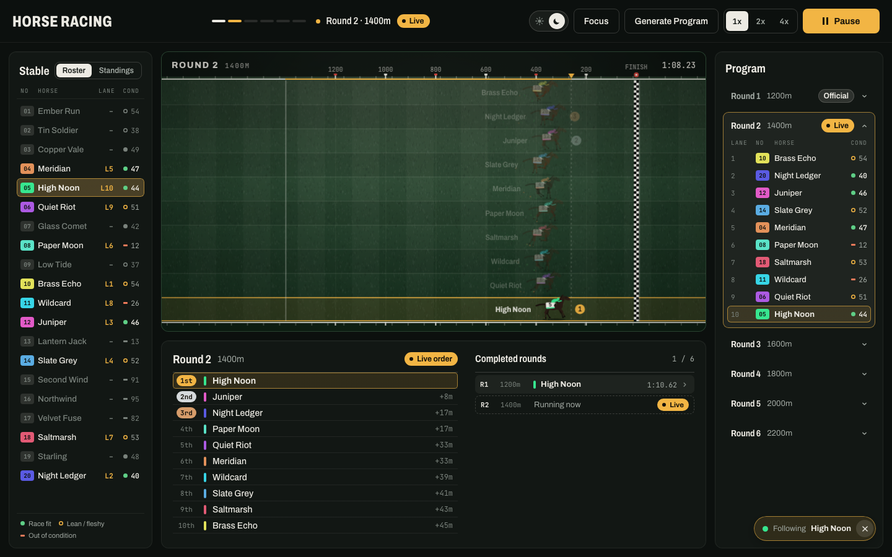

# Horse Racing

An interactive six-round horse racing game built with Vue 3, Pinia and a pure,
deterministic TypeScript race engine. Generate a program of six races, start
it, and watch each round run on an animated track while the live order,
official results and a broadcast-style race clock update alongside.

**Live demo: [horse-racing-vue3.vercel.app](https://horse-racing-vue3.vercel.app/)**
(add `?seed=42` for a reproducible program).

## What to look at

- [A deterministic engine tested without a browser](docs/architecture.md#determinism):
  same seed, same results, whatever the frame rate, speed or pauses.
- [Condition modelled on real horse body condition](docs/domain.md#condition-model):
  performance peaks at 44, not 100.
- [Zero layout shift, verified at six widths](docs/ux.md#zero-layout-shift).



## Quick start

Requires Node 22.22 or newer (`.nvmrc` pins 22).

```bash
nvm use
npm ci
npm run dev        # http://localhost:5173
npm run verify     # lint, types, English check and 619 unit tests
npm run test:e2e   # 46 Playwright tests on the production build
```

The first E2E run needs a browser: `npx playwright install chromium`.

## How to play

1. **Generate Program** draws six rounds (1200 m to 2200 m), each with ten of
   the twenty horses.
2. **Start race** (or Space) runs the rounds one after another.
3. Pause, switch between 1x, 2x and 4x, and click any horse to follow it.
4. When all six rounds are official, **Generate new program** starts again.

Keyboard shortcuts are listed in [UI/UX](docs/ux.md#keyboard).

## The brief, requirement by requirement

| Requirement                                | Where and how                                                                                |
| ------------------------------------------ | -------------------------------------------------------------------------------------------- |
| 20 horses, unique colours, condition 1–100 | Fixed roster, 20 distinct silk hues, researched condition model ([domain](docs/domain.md))   |
| Generate a six-round schedule              | Rounds at 1200 to 2200 m, 10 random runners each                                             |
| Start runs one round at a time             | A pause-aware phase machine ([architecture](docs/architecture.md#the-race-director))         |
| Results appear as each race concludes      | Results board, completed rounds and program standings                                        |
| Horses visibly move                        | Canvas 2D track with gallop, sprint and finish animation                                     |
| Clean code, Pinia, components              | Enforced layers, Pinia setup stores, typed components ([architecture](docs/architecture.md)) |
| Bonus: unit, E2E and visual tests          | 619 Vitest and 46 Playwright tests with screenshot baselines ([quality](docs/quality.md))    |

The brief says the horse list holds "between 1 and 20 horses" but also
requires exactly 20 available horses; the game always generates all 20.

## Development workflow

- **Planning & scope:** I set the architecture, boundaries, and rules up front
  in `CLAUDE.md` (layer isolation, determinism, tests with changes) and made
  the product, UX, and scope decisions throughout—including what not to build.
- **Implementation:** Used Claude Code to speed up implementation,
  refactoring, and test and doc drafting within those constraints.
- **Automated gate:** ESLint layer rules, a DOM-free TypeScript build for the
  core, and `npm run verify` run before committing.
- **Review and approval:** I reviewed changes before committing, inspected UI
  behavior in production builds across viewports, and locked fixes in with
  regression tests.

## Documentation

| Document                                     | Read it for                                                 |
| -------------------------------------------- | ----------------------------------------------------------- |
| [docs/architecture.md](docs/architecture.md) | Layers, determinism, time, state, error handling, extending |
| [docs/domain.md](docs/domain.md)             | The condition model, race times and simplifications         |
| [docs/ux.md](docs/ux.md)                     | Design principles and key interaction decisions             |
| [docs/quality.md](docs/quality.md)           | Test suites, edge cases and known limitations               |
| [CLAUDE.md](CLAUDE.md)                       | Working rules for contributors and coding agents            |
