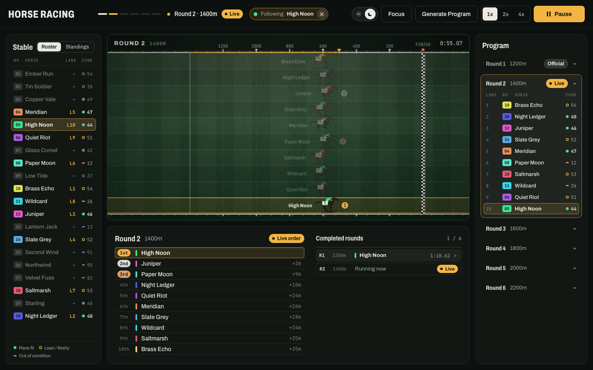

# UI and UX

## Layout

The page is one dashboard with four areas, arranged by viewport width using
CSS grid and media queries only (no JavaScript breakpoints):

| Width          | Arrangement                                                                                        |
| -------------- | -------------------------------------------------------------------------------------------------- |
| ≥ 1180 px      | Three columns: **Stable** \| **Track** over **Results** \| **Program**; the page fits the viewport |
| 760 to 1179 px | Track, then Results, then Program and Stable side by side                                          |
| < 760 px       | One column: Track, Results, Program, Stable; header controls wrap into two rows                    |

The track canvas has its own compact mode below 560 px of its width: name
tags are hidden and labels that would collide with the race clock give way.
End-to-end tests check there is no horizontal scrolling from 320 to 1440 px
and that no horse name is truncated in the tables at those widths.

  

## What each area does

**Header.** Title, six-segment round progress, a live status line with a
pill (At the gates, Starting, Live, Paused, Official), the followed horse,
theme switch, Focus mode, Generate Program, speed (1x, 2x, 4x) and the
Start/Pause/Resume button.

**Track.** Ten lanes with distance poles, a chequered finish, starting gates
and a "3, 2, 1, GO" countdown. Horses gallop with a stride driven by their
speed, jockeys drive in the final stretch, the leader gets a marker, and the
top three carry gold, silver and bronze rank badges. The finish slows to
slow motion around the winner, then a winner card shows the official time.
The race clock in the header reads realistic durations (about 1:12 over
1200 m) while the race itself takes seconds on screen.

**Results.** A leaderboard of ten rows that reorder live during a race and
show official times afterwards, plus a list of completed rounds. Selecting a
finished round shows its full result; **Back to live** returns to the current
round.

**Program.** One card per round with its distance, status pill and line-up.
The current round is highlighted and opens automatically.

**Stable.** All 20 horses, in two views switched by tabs in the panel
header. **Roster**: number, name, lane in the current round and condition;
horses not running in the current round are greyed out. **Standings**:
program points so far (10-8-6-5-4-3-2-1 for 1st to 8th), rank (shared ranks
shown as `=5`), horses yet to race muted at the bottom, and a **Full table**
button for every placing in every round.

**Standings table.** A dialog with one row per horse: rank, horse and
points first, then R1 to R6, each a medal pill for 1st to 3rd, the place for
the rest, a dot for a round the horse is entered in but has not run, or
blank. On narrow screens the rounds scroll sideways inside the dialog while
rank, horse and points stay pinned; the page itself never scrolls sideways.

**Completion dialog.** After round 6, a summary of the six winners with
**Generate new program** (the primary action), **Final standings** and
**View track**.

## Key decisions

**Condition is shown as a band, not just a number.** Because condition peaks
in the middle of the scale ([domain](domain.md#condition-model)), a bare "98"
would mislead. Each score carries a marker whose shape changes with the band:
a filled dot for race fit, a ring for lean or fleshy, a bar for out of
condition. Shape, not only colour, carries the meaning, and the stable panel
has a key. The full description ("Condition 44 of 100 · Race fit · body
condition 4.5 of 9 (Moderately thin)") is the badge's accessible label and
tooltip.

**Start where the user is looking.** After generating, the track shows a
card with the round, distance and field size, a primary **Start race**
button and an "or press Space" hint, instead of a canvas caption pointing at
the header. Focus moves to that button only when the user has just generated
(so Space or Enter starts the race), never away from another control. The
card is an overlay, so it cannot shift the layout; later rounds start
automatically, so it appears only for round 1.

**One path to a new program, with a guard.** Once a program is complete,
Start disappears and Generate becomes the primary button, so there is never
a confusing "restart" of a finished program. Generate works at any moment,
but when it would discard a race in progress or official results, it first
asks "Discard the current program?", names exactly what would be lost
("Round 3 in progress and 2 official results") and pauses the race while
the user decides. The safe choice, **Keep this program**, comes first and has
focus; cancelling resumes only if the dialog was what paused the race. At the
gates and after completion nothing is lost, so Generate stays one click.

**Follow a horse from anywhere, dismiss it the same way.** Clicking a lane on
the track, or a row in the stable, program or results, follows that horse:
its lane is highlighted, the other horses dim, a guide line tracks it and the
header shows a "Following" chip. To stop, press `Esc`, use the chip's close
button, or click anything that is not a control: panel headings, empty
panel space, the page background, or the track outside the lanes. Buttons,
links, form fields and dialogs never clear it, so no intentional interaction
is lost (the rule is one pure function, `isDismissClick`).

**Standings live inside the Stable panel.** The question "who is having the
best program?" spans rounds, which no other view answers. A separate block
below the stable would not fit (the desktop stable column is nearly full,
and the space under Completed rounds shrinks to about 70 px by round 6), so
standings are a second view of the same 20 horses: same rows, same height,
same footer height, so switching tabs never moves anything (asserted at
desktop and mobile widths). The full horse-by-round grid needs room the
column cannot give, which is what the dialog is for. Opening it mid-race
pauses the race, because a blocking dialog should not let a race play out
unseen.

**Pointing at a lane.** With a mouse or pen over the track, the lane under
the pointer gets a neutral, low-contrast wash with hairline edges, and the
cursor becomes a pointer only over lanes, so it is clear which horse a click
will follow. The wash is deliberately not the accent colour: the followed
lane keeps its amber highlight, and hovering it adds nothing on top. Touch
has no hover, so taps never leave a stale highlight. The hovered lane is
local UI state in the track's loop composable, redrawn by the canvas; it
never reaches the stores or the race.

**Hover is not selection.** Hovering a runner row shows a soft wash only
(`--row-hover`); the followed row keeps the accent fill and ring, and
hovering it simply deepens the fill. The two states can never be confused.

**Live means live.** Every Live pill carries a small dot with an expanding
ring, so a running race is noticeable at a glance. It animates only
`transform` and `opacity`, uses the pill's own text colour (legible in both
themes), is hidden from assistive technology, and holds still under
reduced motion.

**Podium at a glance.** In the results board, 1st, 2nd and 3rd are gold,
silver and bronze pills matching the medals on the track; every position
sits in the same fixed-width, centred box, so the column stays aligned while
rows reorder.

**One way to look inactive.** Horses sitting out the current round use a
single treatment from two tokens (`--inactive-fg`, `--inactive-bg`): a
neutral number chip, faint text and a gray condition marker that keeps its
shape. Previously each silk colour was desaturated with a filter, which
produced a different gray for every horse.

**Focus mode** (`F`) dims the side panels so the track stands out, without
hiding any information.

**The PAUSED pill never covers anything.** It is drawn after the round
distance in the track header, and distance labels that would overlap it, or
the race clock, are skipped.

## Zero layout shift

Live data changes every frame, so the layout is built not to move:

- Leaderboard rows are absolutely positioned and reorder with `transform`;
  the list keeps a fixed height.
- Times and numbers use a tabular monospace font, and the timeboard format
  `m:ss.cc` has a constant width.
- The Start/Pause/Resume button has a minimum width, so its label can change
  without resizing the header.
- Pills and rows have fixed heights.

An end-to-end test measures the header, canvas, results and panels before
and after Start, Pause and Resume and requires identical boxes.

## Keyboard

| Key         | Action                                           |
| ----------- | ------------------------------------------------ |
| `Space`     | Start, pause or resume                           |
| `1` `2` `4` | Playback speed                                   |
| `F`         | Focus mode                                       |
| `T`         | Light or dark theme                              |
| `Esc`       | Stop following, then leave focus mode            |
| `Enter`     | In the completion dialog: generate a new program |
| `Esc`       | In the completion dialog: view the track         |
| `Esc`       | In the discard confirmation: keep the program    |
| `Esc`       | In the standings table: close it                 |

Shortcuts are ignored while typing in a field and with modifier keys. Space
on a focused button activates that button instead of toggling playback twice.
While a dialog is open, only its own keys work, and `Enter` never confirms
the destructive discard: only the focused button can.

## Accessibility

- Every clickable row is a native `<button>`. Toggles expose `aria-pressed`,
  round cards `aria-expanded`, and the theme control is a `switch`. The
  Roster and Standings views follow the WAI-ARIA tabs pattern (arrow keys,
  Home and End, one tab stop).
- The standings table is a real `<table>` with a caption and row and column
  headers; each round cell has text for screen readers ("entered, not run
  yet", "not running"), and each standings row's label reads as a sentence
  ("rank 1, 18 points from 2 runs (1st in round 1, 2nd in round 3)").
- The status line is an `aria-live="polite"` region, so state changes are
  announced without interrupting.
- The canvas has `role="img"` with a label that describes the current state.
- All dialogs are `aria-modal`: focus moves inside (the primary action in
  the completion dialog, the safe action in the discard confirmation, Close
  in the standings table), Tab
  cycles inside, the page behind is made `inert`, and focus returns to where
  it was when they close. The confirmation is also `aria-describedby` its
  warning text.
- Visible focus rings on every control; icon-only buttons have labels.
- Theme colours are tokens tuned separately for light and dark; colour is
  never the only carrier of meaning (condition markers, medals with text).
- `prefers-reduced-motion` shortens CSS transitions and stops the Live pulse.
  The canvas animation is the game itself and still runs.

## Theme and visual language

Dark is the default; light is one keystroke away and remembered in
`localStorage` (if storage is blocked, the theme still switches for the
session). Colours, radii and spacing are CSS custom properties in
`src/styles/tokens.css`; the canvas palette in `src/render/palette.ts`
mirrors them. Typography is Archivo (a variable font whose width axis gives
the condensed headings) with JetBrains Mono for numbers, both self-hosted.

## Component structure

| Kind           | Components                                                                                                    | Rule                                  |
| -------------- | ------------------------------------------------------------------------------------------------------------- | ------------------------------------- |
| Containers     | `AppHeader`, `RaceTrack`, `ResultsPanel`, `ProgramPanel`, `StablePanel`, `ProgramCompleteDialog`              | Read stores, wire events              |
| Presentational | `ResultsLeaderboard`, `CompletedRounds`, `RoundCard`, `StableTable`, `StatusIndicator`, `ConditionBadge`, ... | Typed props in, events out; no stores |
| Wrappers       | `DashboardLayout`, `PanelCard`, `ModalDialog`                                                                 | Structure or behaviour through slots  |

Presentational components receive view models built by pure functions, so a
component test only needs props.
