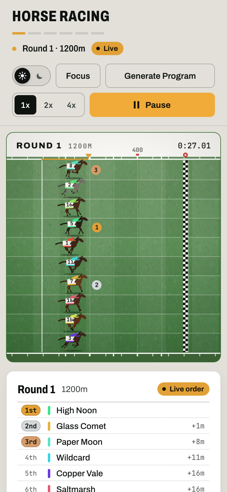

# UI and UX

Everything here can be tried in the [live demo](https://horse-racing-vue3.vercel.app/).

## Layout

One dashboard with four areas, arranged with CSS grid and media queries only:

| Width          | Arrangement                                                                                        |
| -------------- | -------------------------------------------------------------------------------------------------- |
| ≥ 1180 px      | Three columns: **Stable** \| **Track** over **Results** \| **Program**; the page fits the viewport |
| 760 to 1179 px | Track, then Results, then Program and Stable side by side                                          |
| < 760 px       | One column: Track, Results, Program, Stable; header controls wrap into two rows                    |

Below 560 px of its own width the track canvas switches to a compact mode:
name tags hide and labels that would collide with the race clock give way.
There is no horizontal scrolling and no truncated horse name from 320 to
1440 px.

  

## The areas

- **Header:** title, six-segment round progress, a status line with a pill
  (At the gates, Starting, Live, Paused, Official), theme switch, Focus mode,
  Generate Program, speed (1x, 2x, 4x) and Start/Pause/Resume.
- **Track:** ten lanes, distance poles counting down to a chequered finish,
  starting gates and a "3, 2, 1, GO" countdown. Strides follow speed, jockeys
  drive in the final stretch, the top three wear rank badges, and the finish
  slows down around the winner before a winner card shows the official time.
  The race clock reads realistic durations (about 1:12 over 1200 m) while the
  race takes seconds on screen.
- **Results:** a ten-row leaderboard that reorders live and then shows
  official times, plus completed rounds. Selecting a finished round shows its
  full result; **Back to live** returns to the current one.
- **Program:** one card per round with distance, status pill and line-up; the
  current round opens automatically.
- **Stable:** all 20 horses in two tabs. **Roster** shows number, name, lane
  in the current round and condition, with horses sitting out greyed.
  **Standings** shows rank (`=5` when shared), movement since the last round
  (`▲2`, `▼1`) and points; its footer holds the context ("After 2 of 6
  rounds") and a **Full table** button. Both tabs have the same rows and
  footer height, so switching never moves anything.

## Dialogs

- **Standings table:** rank, horse and points, then R1 to R6 (medal pill for
  1st to 3rd, the place otherwise, a dot when entered but not yet run). On
  narrow screens the rounds scroll inside the dialog while rank, horse and
  points stay pinned. Opening it mid-race pauses the race; closing resumes it
  only if the dialog paused it.
- **Completion summary:** the six winners, **Generate new program** as the
  full-width primary action, and **Final standings** and **View track** as
  equal secondary actions. Only **View track** dismisses it; **Final
  standings** opens the table in front of it, and closing the table returns to
  the summary with focus on **Final standings**.
- **Discard confirmation:** Generate during a round or with official results
  asks "Discard the current program?", names what would be lost ("Round 3 in
  progress and 2 official results") and pauses while the user decides. **Keep
  this program** comes first and has focus. At the gates and after
  completion nothing is lost, so Generate stays one click.

**Two dismissal rules.** The summary and the discard confirmation are
_decisions_: every action is a labelled button, there is no ✕ and the
backdrop does nothing, so a stray click never decides for the user. The
standings table is a _viewer_: a top-right ✕, a backdrop click or Esc closes
it (the ✕ reads "Back to summary" when stacked on the summary). A backdrop
click counts only when the press also started there, so dragging a text
selection out of the table never closes it. The viewer's footer holds only
the forward action, **Generate new program** once the program is complete.

## Key decisions

- **Condition is a band, not just a number.** Condition peaks mid-scale
  ([domain](domain.md#condition-model)), so a bare "98" would mislead. Each
  score carries a marker whose shape follows the band: filled dot for race
  fit, ring for lean or fleshy, bar for out of condition, with a key in the
  stable and the full description as the accessible label.
- **Start where the user is looking.** After generating, a card over the track
  offers **Start race** with an "or press Space" hint and takes focus, so
  Space or Enter starts. It appears only at the gates of round 1; later rounds
  start automatically.
- **One path to a new program.** After completion, Start disappears and
  Generate becomes the primary button, so a finished program is never
  "restarted".
- **Follow from anywhere, dismiss the same way.** Clicking a lane or any row
  follows that horse: its lane is highlighted, the others dim, a guide line
  tracks it and a "Following" badge appears in the bottom-right corner. Esc,
  the badge's ✕ or a click on anything that is not a control stops it;
  buttons, fields and dialogs never do (`isDismissClick`).
- **Standings in the Stable panel.** "Who is having the best program?" spans
  rounds and no other view answers it. There is no room for a separate block,
  so standings are a second view of the same 20 rows; the full horse-by-round
  grid lives in the dialog.
- **Movement only where it means something.** `▲2` appears in the standings,
  which change once per round. The live leaderboard republishes four times a
  second, so arrows there would flicker; its rows slide instead.
- **Hover is not selection.** Hovered rows and track lanes get a neutral wash;
  the followed one keeps its amber fill, and hovering it adds nothing. Over
  the track the cursor becomes a pointer only over lanes; touch never hovers.
- **Live means live.** Live pills carry a pulsing dot (`transform` and
  `opacity` only, hidden from assistive technology, stopped under reduced
  motion).
- **Podium at a glance.** 1st to 3rd on the board are gold, silver and bronze
  pills matching the track, in a fixed-width box so the column stays aligned.
- **One inactive look.** Horses sitting out use one token pair
  (`--inactive-fg`, `--inactive-bg`): a neutral chip, faint text and a grey
  condition marker that keeps its shape.
- **Focus mode** (`F`) dims the side panels without hiding information.
- **The PAUSED pill never covers anything.** It follows the round distance in
  the track header; distance labels that would overlap it or the clock are
  skipped.

## Zero layout shift

Live data changes every frame, so nothing is allowed to move the layout:

- Leaderboard rows are absolutely positioned and reorder with `transform` in
  a fixed-height list.
- Numbers use tabular monospace digits; `m:ss.cc` has a constant width.
- Start/Pause/Resume has a minimum width; pills and rows have fixed heights.
- The "Following" badge is fixed to the viewport's bottom-right corner,
  outside every layout. On desktop it rests in the empty lower part of the
  Program panel. Below 1180 px the page keeps a permanent bottom clearance
  (`--float-clearance`), so at the end of the scroll the badge sits below the
  last panel; the clearance is always present, so following never changes the
  page height.

End-to-end tests compare element boxes before and after Start, Pause and
Resume, and before and after following a horse at six widths (320 to
1440 px), and check that the badge covers neither header, track nor panel
content.

## Keyboard

| Key         | Action                                               |
| ----------- | ---------------------------------------------------- |
| `Space`     | Start, pause or resume                               |
| `1` `2` `4` | Playback speed                                       |
| `F`         | Focus mode                                           |
| `T`         | Light or dark theme                                  |
| `Esc`       | Stop following, then leave focus mode                |
| `Enter`     | In the completion dialog: generate a new program     |
| `Esc`       | In the completion dialog: view the track             |
| `Esc`       | In the discard confirmation: keep the program        |
| `Esc`       | In the standings table: back to the summary or close |
| `Enter`     | In the final standings: generate a new program       |

Shortcuts are ignored while typing and with modifier keys. Space on a focused
button activates that button. While a dialog is open only its keys work, and
Enter never confirms the discard: only the focused button can.

## Accessibility

- Clickable rows are native `<button>`s; toggles expose `aria-pressed`, round
  cards `aria-expanded`, the theme control is a `switch`, and Roster and
  Standings follow the WAI-ARIA tabs pattern (arrows, Home, End, one tab stop).
- The standings table is a real `<table>` with caption and headers; round
  cells have screen-reader text ("entered, not run yet", "not running"), and
  standings rows read as a sentence ("rank 1, 18 points from 2 runs (1st in
  round 1, 2nd in round 3)").
- The status line is `aria-live="polite"`; the canvas is `role="img"` with a
  label describing the current state.
- Dialogs are `aria-modal` with a focus trap, an `inert` background and focus
  restored on close. Initial focus: Generate in the summary, Keep in the
  discard confirmation, the scrollable table region in the standings.
- Visible focus rings everywhere; icon-only buttons have labels. Colour never
  carries meaning alone (condition markers, medals with text).
- `prefers-reduced-motion` shortens CSS transitions and stops the Live pulse;
  the race animation itself still runs.

## Theme

Dark by default; `T` switches to light and the choice is remembered (if
storage is blocked, it still applies for the session). Colours, radii and
spacing are tokens in `src/styles/tokens.css`, mirrored for the canvas in
`src/render/palette.ts`. Type is Archivo (its width axis gives the condensed
headings) with JetBrains Mono for numbers, both self-hosted.
