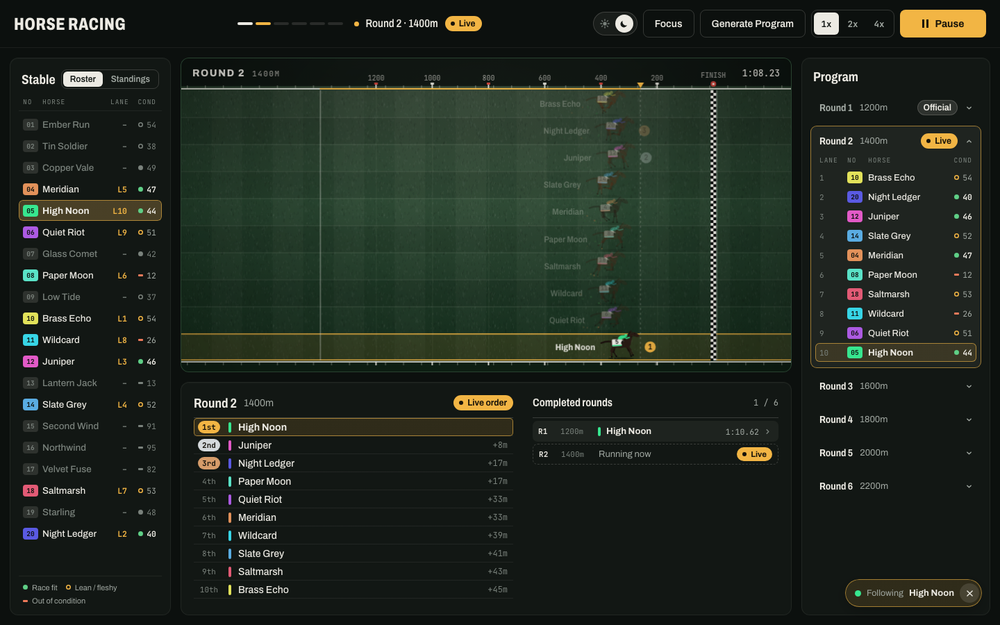

# UI and UX

Everything here can be tried in the [live demo](https://horse-racing-vue3.vercel.app/).

## Design principles

- **Calm dashboard.** Motion lives only on the track and the live board;
  every other panel stays still while a race runs.
- **Zero layout shift.** No state change moves the layout, and end-to-end
  tests measure it.
- **Decisions cannot be made by accident.** Dialogs that decide something have
  no close button and ignore the backdrop.

## Key decisions

- **Condition is a band, not a number.** Condition peaks mid-scale
  ([domain](domain.md#condition-model)), so each score carries a dot, ring or
  bar for its band; a bare "98" would read as excellent when it means
  overweight.
- **Start where the user is looking.** After Generate, a Start race card over
  the track takes focus, because the user's eyes are on the track, not the
  header. It appears only for round 1; later rounds start automatically.
- **One path to a new program.** After the last round, Start disappears and
  Generate becomes the primary action, so a finished program is never
  "restarted".
- **Decision dialogs vs the viewer.** The completion summary and the discard
  confirmation need an explicit choice; the standings table is read-only, so
  ✕, Esc or a backdrop click close it. A stray click should never discard a
  program, but leaving a table should be effortless.
- **The follow badge lives outside the layout.** It is fixed to the
  bottom-right corner, because every in-layout placement either moved the
  round text or covered a runner.
- **Movement arrows only in the standings.** `▲2` appears where ranks change
  once per round; on the live board, which updates four times a second, arrows
  would flicker.

## Layout

| Width          | Arrangement                                                                                        |
| -------------- | -------------------------------------------------------------------------------------------------- |
| ≥ 1180 px      | Three columns: **Stable** \| **Track** over **Results** \| **Program**; the page fits the viewport |
| 760 to 1179 px | Track, then Results, then Program and Stable side by side                                          |
| < 760 px       | One column: Track, Results, Program, Stable                                                        |

Breakpoints are CSS only; the canvas has its own compact mode below 560 px.

## Zero layout shift

- Leaderboard rows are absolutely positioned and reorder with `transform`.
- Numbers use tabular digits, and `m:ss.cc` has a constant width.
- Stateful buttons have a minimum width; rows and pills have fixed heights.
- Overlays (the Start race card, the follow badge) sit outside the flow. Below
  1180 px the page keeps a permanent bottom clearance (`--float-clearance`)
  for the badge, so following never changes the page height.

End-to-end tests compare element boxes before and after Start, Pause and
Resume and before and after following a horse at six widths from 320 to
1440 px.

## Keyboard

| Context              | Key         | Action                                  |
| -------------------- | ----------- | --------------------------------------- |
| Anywhere             | `Space`     | Start, pause or resume                  |
| Anywhere             | `1` `2` `4` | Playback speed                          |
| Anywhere             | `F` / `T`   | Focus mode / theme                      |
| Anywhere             | `Esc`       | Stop following, then leave focus mode   |
| Completion summary   | `Enter`     | Generate a new program                  |
| Completion summary   | `Esc`       | View the track                          |
| Discard confirmation | `Esc`       | Keep the program (Enter never confirms) |
| Standings table      | `Esc`       | Close, or back to the summary           |
| Final standings      | `Enter`     | Generate a new program                  |

Shortcuts are ignored while typing in a field.

## Accessibility

- The canvas exposes a summary label; everything it shows is repeated in
  accessible tables.
- Colour never carries meaning alone: condition bands have shapes, medals
  have text.
- Standings rows read as sentences ("rank 1, 18 points from 2 runs (1st in
  round 1, 2nd in round 3)").
- The status line is `aria-live="polite"`, so state changes are announced
  without interrupting.

## Theme

Dark by default, light on `T`; colours are tokens in `src/styles/tokens.css`,
mirrored for the canvas in `src/render/palette.ts`.
